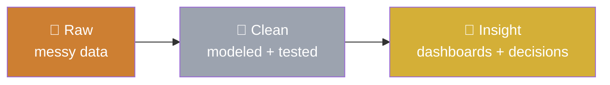

<!-- Profile README for github.com/SanketPrabhune04/SanketPrabhune04 -->
<!-- Replace: YOUR_LINKEDIN_URL, YOUR_EMAIL, and the repo link under "Featured Project" -->

<div align="center">


## 👋 Rushikesh Karale


<a href="YOUR_LINKEDIN_URL"></a>
<a href="mailto:YOUR_EMAIL"></a>


<br/><br/>

<!-- Contribution snake (needs the GitHub Action from the guide, Step 6) -->
<picture>
  <source media="(prefers-color-scheme: dark)" srcset="https://raw.githubusercontent.com/SanketPrabhune04/SanketPrabhune04/output/github-snake-dark.svg"/>
  <source media="(prefers-color-scheme: light)" srcset="https://raw.githubusercontent.com/SanketPrabhune04/SanketPrabhune04/output/github-snake.svg"/>
  
</picture>

</div>


```sql
SELECT
    name           AS "Rushikesh Karale",
    role           AS "Data Analyst",
    location       AS "Pune, Maharashtra, India",
    education      AS "BCA, MS Data Science",
    superpower     AS "Turning raw data into business decisions",
    current_focus  AS "DATA ANALYSIS"
FROM   humans
WHERE  curiosity = 'high'
  AND  coffee_level > 0
ORDER  BY impact DESC;
```


<div align="center"><i>I treat every problem like a <b>data pipeline</b> — take it raw, refine it, serve it as a decision.</i></div>




<div align="center">


<br/><br/>


<br/>


<br/>


</div>


<div align="center">

### 🛒 Retail Sales Data Pipeline

**Medallion architecture on Databricks**
incremental loading · SCD Type 2 · star schema · surrogate keys · data quality · orchestration

`Bronze 🥉 → Silver 🥈 → Gold 🥇 → 📊 Analytics`

<a href="https://github.com/SanketPrabhune04/databricks-medallion-pipeline"></a>

</div>


```diff
+ ❄️  Snowflake data warehousing & cloud data pipelines
+ ☁️  Azure cloud services & data engineering
+ 📊  Advanced DAX & Power BI data modeling
+ ⚡  Power Platform solutions for enterprise automation
+ 🐍  Python for data analysis & automation
```


<div align="center">

*"Turning raw data into business decisions."*

<a href="YOUR_LINKEDIN_URL"></a>
<a href="mailto:YOUR_EMAIL"></a>


</div>
